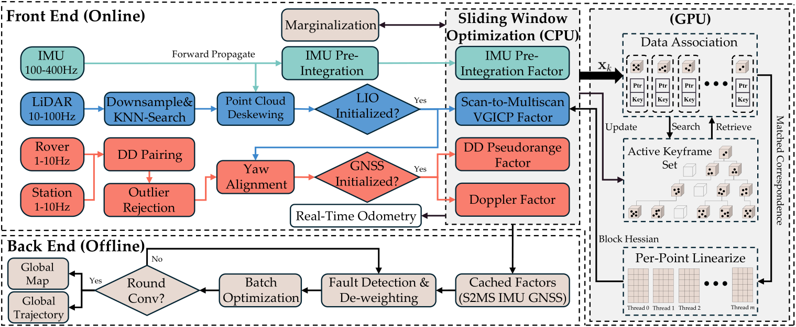
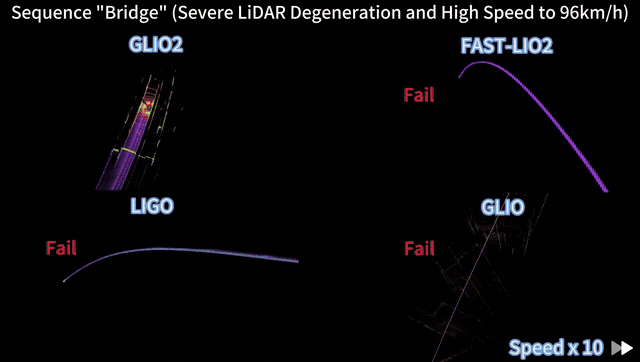
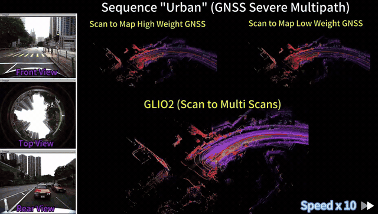
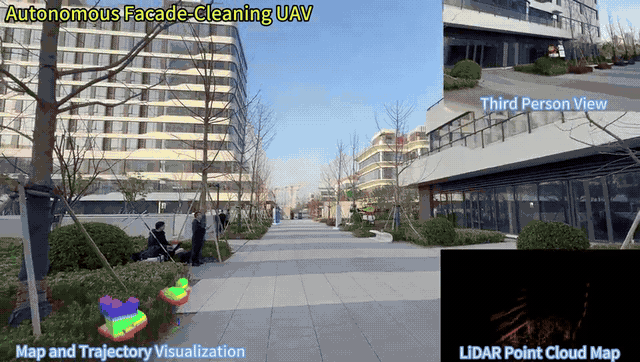
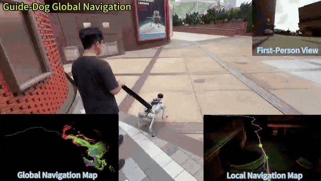
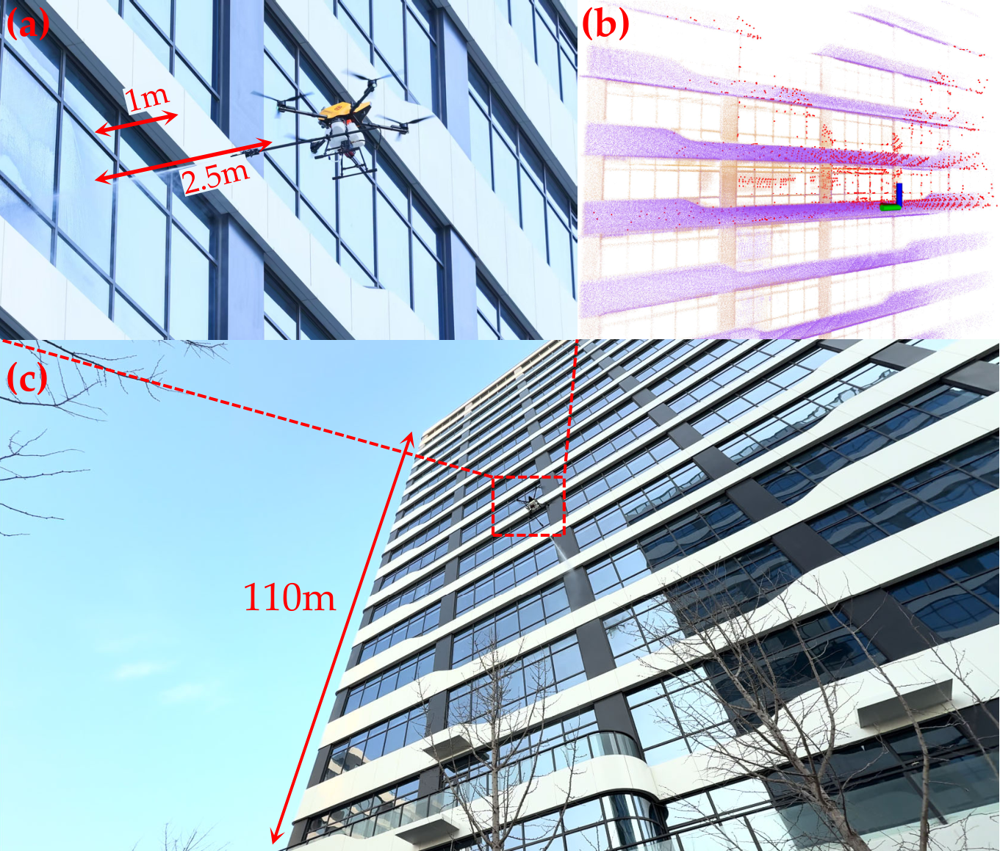
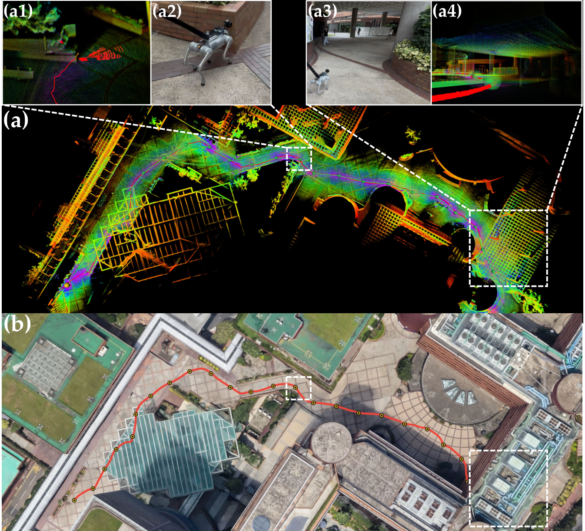

# GLIO2

### [GLIO2: A GPU-Parallelized Tightly-Coupled LiDAR–Inertial–GNSS System for Robust and Real-Time Global Localization and Mapping](https://arxiv.org/abs/2610.12411)

### 📢 News

- 📄 **2026-10-08**: Paper released on [arXiv](https://arxiv.org/abs/2610.12411).

### 📄 Related Papers

- [GLIO2: A GPU-Parallelized Tightly-Coupled LiDAR–Inertial–GNSS System for Robust and Real-Time Global Localization and Mapping](https://arxiv.org/abs/2610.12411)
- [GLIO: Tightly-Coupled GNSS/LiDAR/IMU Integration for Continuous and Drift-free State Estimation of Intelligent Vehicles in Urban Areas](https://ieeexplore.ieee.org/document/10285475/)

## 1. Introduction

GLIO2 is a GPU-parallelized, tightly-coupled LiDAR–inertial–GNSS system for robust and real-time global localization and mapping in challenging environments such as long bridges and urban canyons.

  

### 1.1 Demo video

<table>
  <tr>
    <td align="center" width="50%">
      
       <b>🌉 Cross-Sea Bridge</b>
       LiDAR degeneracy · high-speed driving
    </td>
    <td align="center" width="50%">
      
       <b>🏙️ Urban Canyon</b>
       Severe GNSS multipath
    </td>
  </tr>
  <tr>
    <td align="center" width="50%">
      
       <b>🚁 Facade-Cleaning UAV</b>
       Autonomous cleaning on a 110 m high-rise facade
    </td>
    <td align="center" width="50%">
      
       <b>🐕 Robotic Guide Dog</b>
       Globally referenced navigation in pedestrian scenes
    </td>
  </tr>
</table>

### 1.2 Applications

<table>
  <tr>
    <td align="center" width="50%">
      
       <b>Autonomous Facade-Cleaning UAV</b>
    </td>
    <td align="center" width="50%">
      
       <b>Robotic Guide-Dog Navigation</b>
    </td>
  </tr>
</table>

## 2. Code Release

The code will be open-sourced once the paper is accepted.

## 3. Acknowledgements

GLIO2 builds on these excellent open-source projects:
[GLIO](https://github.com/XikunLiu-huskit/GLIO),
[GLIM](https://github.com/koide3/glim),
[GTSAM](https://github.com/borglab/gtsam),
[gnss_comm](https://github.com/HKUST-Aerial-Robotics/gnss_comm), and
[RTKLIB](https://github.com/tomojitakasu/RTKLIB).
We also thank the authors of the [UrbanNav dataset](https://github.com/IPNL-POLYU/UrbanNavDataset).

## 4. Contact

For further inquiries or assistance, please contact [qiiiii.zhang@connect.polyu.hk](mailto:qiiiii.zhang@connect.polyu.hk).
